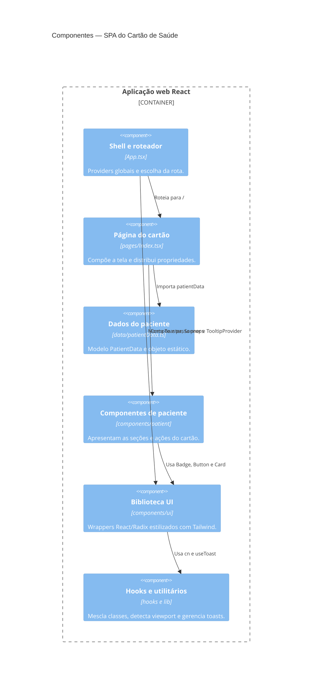

# C4 — Componentes da aplicação web

## Observações

- Os componentes de paciente são consumidores; não mantêm o modelo nem o persistem.
- A dependência TanStack Query está montada no shell, mas o fluxo da página não contém query.
- A sidebar e `NavLink` são componentes reutilizáveis sem uso identificado na página principal.
- As relações representam imports/uso observados, não chamadas HTTP.

**Confiança:** 🟢 **CONFIRMADO** — estrutura e imports do caminho principal.
