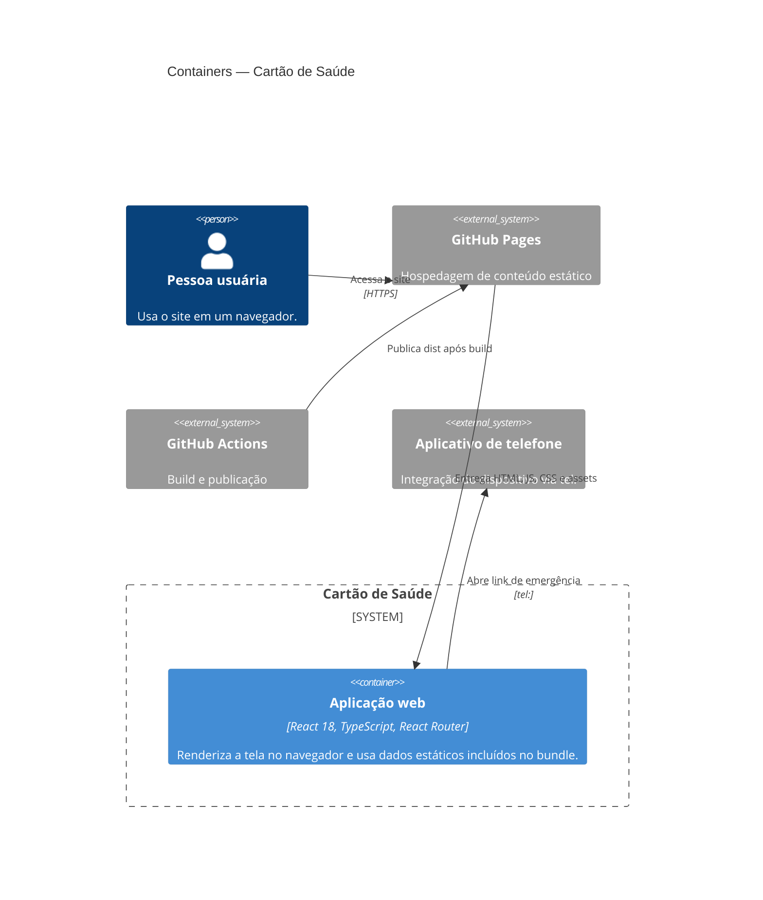

# C4 — Containers

## Inventário

| Container/serviço | Papel | Dados/tecnologia |
|---|---|---|
| Aplicação web no navegador | Renderiza rotas e conteúdo | React/TypeScript compilado pelo Vite |
| GitHub Pages | Hospeda e serve arquivos do build | Conteúdo estático em `dist` |
| GitHub Actions | Constrói e publica a aplicação | Node 20, npm, Vite |
| Banco de dados/API | Não identificado | Não há container correspondente |

O workflow de publicação é um processo de build/deploy, não um serviço ativo de runtime.

**Confiança:** 🟢 **CONFIRMADO** — configuração do Vite e workflow; nenhuma infraestrutura de backend encontrada.
