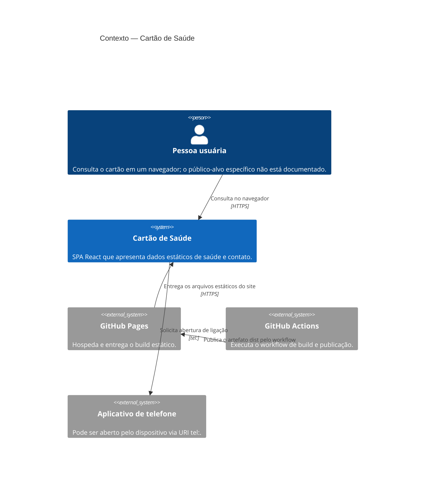

# C4 — Contexto

## Limites de contexto

- GitHub Actions participa da publicação, não de uma chamada de runtime do cartão.
- GitHub Pages serve os arquivos estáticos; o fluxo de usuário executa no navegador.
- O link telefônico delega a ação ao sistema/navegador do dispositivo.
- Não foram identificados provedores de API, serviços de identidade ou banco de dados.

**Confiança:** 🟢 **CONFIRMADO** para os caminhos e integração de deploy configurados; público pretendido e visibilidade efetiva do site são 🔴 **LACUNA**.
