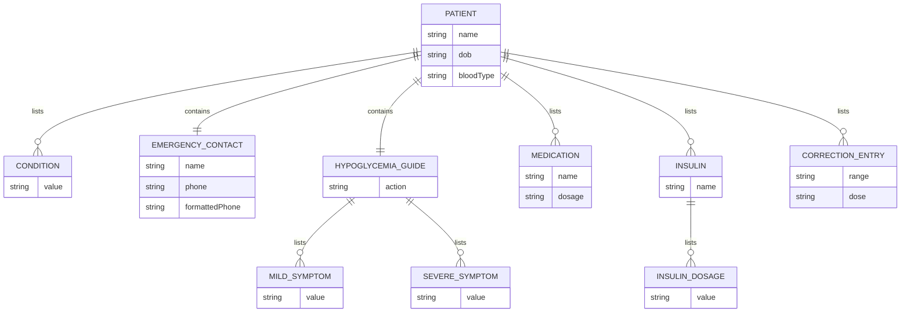

# ERD lógico — dados apresentados

## Interpretação

- O diagrama representa a forma lógica de um objeto TypeScript, não tabelas persistidas.
- Os arrays podem conter zero ou mais elementos; o código não define tamanho mínimo.
- Não existem IDs, chaves primárias/estrangeiras ou relações entre registros persistidos.
- Tipos aninhados são declarados inline dentro de `PatientData`.
- Valores pessoais e clínicos concretos foram omitidos.

**Confiança:** 🟢 **CONFIRMADO** para campos e agregação no tipo; cardinalidades de persistência não se aplicam porque não há banco identificado.
