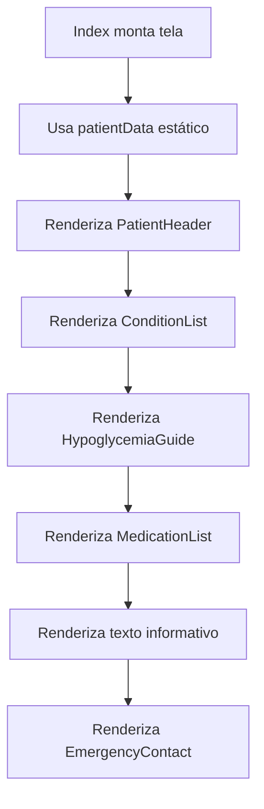

# Fluxo por função — `Index`

Não há ramificações de negócio: as seções são sempre renderizadas, e seus itens dependem apenas dos arrays presentes nos dados importados.

**Confiança:** 🟢 CONFIRMADO — `src/pages/Index.tsx`.
