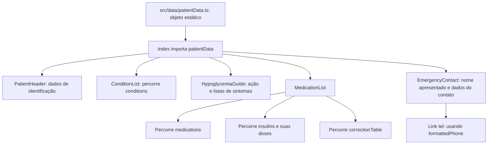

# Fluxo — cartão de saúde do paciente

## Funções e comportamento

- `Index` (`src/pages/Index.tsx`) coordena a composição da tela e encaminha fatias de `patientData` para componentes de apresentação.
- `PatientHeader`, `ConditionList`, `HypoglycemiaGuide`, `MedicationList` e `EmergencyContact` renderizam os dados recebidos por props.
- `MedicationList`, `ConditionList` e `HypoglycemiaGuide` percorrem arrays para renderizar seus itens; não há cálculo de dose, avaliação de sintomas ou edição dos valores.
- `EmergencyContact` expõe o telefone por meio do protocolo `tel:` do navegador/dispositivo.

## Limites observados

- Os dados são importados de um objeto TypeScript estático; não há leitura de API, banco, armazenamento local ou formulário.
- Não há estado de domínio, validação, conversão de data/telefone ou mutação de dados no fluxo da tela.
- Este documento descreve o formato e o fluxo sem reproduzir valores pessoais ou clínicos.

**Confiança:** 🟢 CONFIRMADO — componentes e modelo observados diretamente no código.
