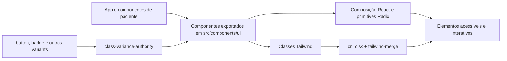

# Fluxo — componentes de interface

## Organização e uso observado

- `src/components/ui/` contém 48 componentes TSX de apresentação, em sua maioria adaptadores tipados que encaminham props/ref para primitivas Radix UI.
- Variantes visuais usam `class-variance-authority`; `cn` combina classes condicionais com `clsx` e resolve conflitos Tailwind com `tailwind-merge`.
- A tela de paciente usa diretamente `Badge`, `Button` e `Card`/`CardContent`. `App` inclui `Toaster`, o wrapper `Sonner` e `TooltipProvider`. `MedicationList` importa `Separator`, mas não o utiliza.
- O diretório contém também componentes para diálogos, menus, formulários, navegação, calendários, gráficos e sidebar; não há evidência de uso direto desses componentes na tela principal.
- O toast baseado em Radix usa o estado e reducer do módulo `src/hooks/use-toast.ts`; não foram localizadas chamadas da função `toast` na tela atual.

## Limites observados

- Os wrappers fornecem composição, acessibilidade e estilo, não regras do domínio do paciente.
- A maior parte do estado visual/interação é delegada às primitivas Radix; o módulo não persiste dados.
- Não há lógica de negócio ou algoritmo não-trivial próprio no módulo.

**Confiança:** 🟢 CONFIRMADO — código dos wrappers principais e imports do aplicativo inspecionados.
