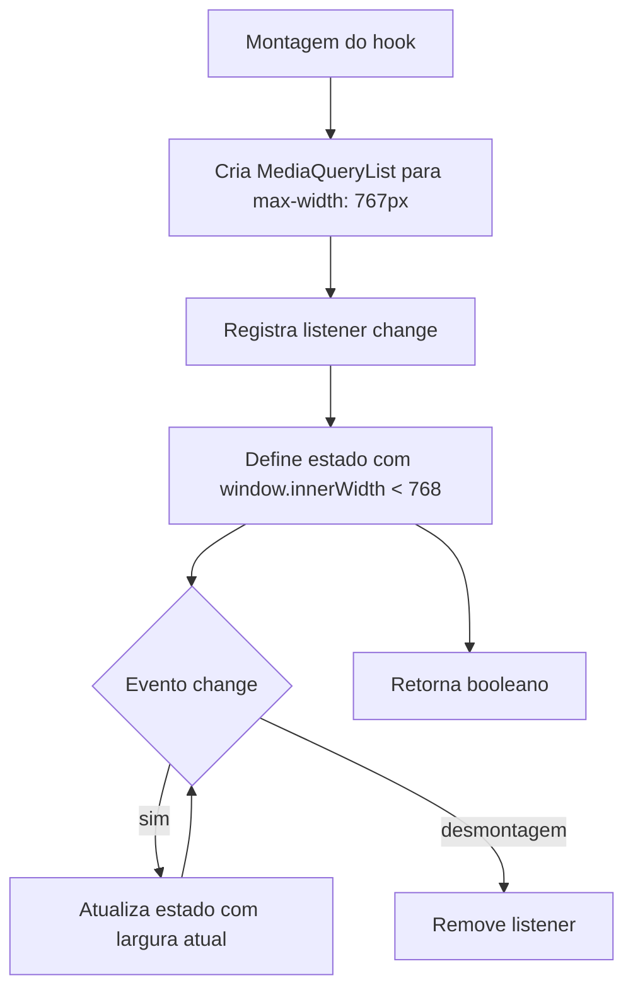

# Fluxo por função — `useIsMobile`

O estado começa como `undefined` e a saída do hook converte esse estado inicial para `false` via coerção booleana.

**Confiança:** 🟢 CONFIRMADO — `src/hooks/use-mobile.tsx`.
