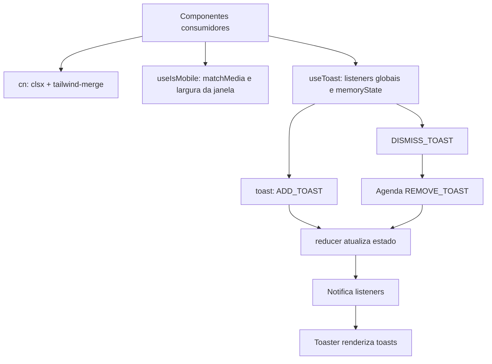

# Fluxo — infraestrutura compartilhada

## Funções e estruturas principais

- `cn` normaliza classes condicionais e elimina conflitos de utilitários Tailwind.
- `useIsMobile` inicializa a largura responsiva com `window.innerWidth < 768`, registra o evento `change` de `matchMedia` e remove o listener no cleanup.
- `useToast` expõe o estado global em memória e ações para adicionar, atualizar e dispensar toasts. Um array global de listeners propaga mudanças às instâncias do hook.
- `reducer` limita a fila a um toast, substituindo a lista pelo item recém-adicionado. Atualização e remoção são por `id`; dispensar fecha o toast e agenda a remoção.
- `NavLink` adapta `NavLink` do React Router para aceitar classes `activeClassName`/`pendingClassName` e mescla as classes com `cn`.
- A sidebar utiliza o hook responsivo; quando renderizada, seu estado desktop é salvo em cookie por sete dias e pode ser alternado por atalho de teclado.

## Limites e integrações

- O estado de toast existe apenas em memória; não há persistência ou transporte de rede.
- O hook de viewport depende de APIs do navegador (`window.matchMedia` e `window.innerWidth`).
- O wrapper `src/components/ui/use-toast.ts` apenas reexporta a implementação do hook.
- `NavLink` não tem consumidor identificado na tela atual; o hook de mobile é usado pela sidebar, que também não é montada na tela atual.

**Confiança:** 🟢 CONFIRMADO — hooks/utilitários e seus consumidores verificados.
