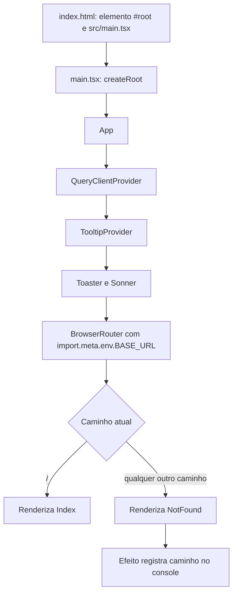

# Fluxo — shell e navegação

## Inicialização e roteamento

## Funções principais

- `App` (`src/App.tsx`): monta os providers globais e declara uma rota explícita para `/`, seguida de uma rota curinga para `NotFound`. O `QueryClient` é criado uma vez no escopo do módulo e usa as configurações padrão.
- `NotFound` (`src/pages/NotFound.tsx`): lê `location.pathname`, registra o caminho no console quando ele muda e apresenta uma âncora para `/`.
- Bootstrap (`src/main.tsx`): procura `#root` e entrega o componente `App` ao React DOM. O non-null assertion do elemento não adiciona validação em runtime.

## Observações e limites

- A única rota funcional de conteúdo é `/`; não há endpoints HTTP nem guardas de autenticação identificados.
- `BrowserRouter` usa a base configurada pelo Vite, importante para a publicação sob subcaminho no GitHub Pages.
- `App.css` existe, mas não é importado pelo caminho de inicialização (`main.tsx` importa `index.css`).
- O link de retorno de `NotFound` é um `<a href="/">`, portanto faz navegação do navegador em vez de usar o roteador.

**Confiança:** 🟢 CONFIRMADO — comportamento observado diretamente nos arquivos listados.
